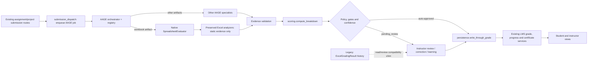

# AAGE — Final delivery report

**Status: FINAL; updated 2026-11-22 for Excel/AAGE consolidation.** Every figure
below comes from an executed command recorded in `06_PHASE_REPORTS.md`,
`05_ENGINEERING_REPORT.md` or `AAGE_EXCEL_INTEGRATION_TRACKER.md`. This file
deliberately separates working software, verified software and explicit
limitations.

---

## 1. Initial audit (as found)

The repository already contained a substantial but uncommitted AAGE implementation:
14 additive tables, services A–O, five evaluators, an orchestrator, persistent jobs,
review/learning/calibration scaffolding, `/api/v1/aage`, a worker, analytics, audit
logging and frontend pages. It reused the Flask/SQLAlchemy monolith, existing
`Rubric`/`AssignmentSubmission`/`ProjectSubmission` models, existing JWT/roles,
the existing AI provider manager, Excel grading analyzers, and the canonical
grade/progress/certificate path.

Four independent audits (backend, frontend, database/migrations, QA/security)
found that the architecture was broadly correct but the following were missing or
broken: migration idempotency/fresh upgrade; rubric payload aliases and non-finite
number handling; cancellation/retry/stale-lock safety; a hard deterministic publish
gate; policy persistence; learning-example candidate scores and per-evaluator
reliability; course ownership on several endpoints; frontend policy units, reports,
history and role gating; and explicit E2E/cost instrumentation. The full audit is in
`00_REPOSITORY_AUDIT_AND_PLAN.md`, especially §8.

## 2. Original vs final implementation

| Area | Original state | Final state |
|---|---|---|
| Database | Drifted, non-idempotent AAGE migration; broken fresh upgrade; DDL outside advisory lock | Guarded additive migration, single head, fresh-upgrade bootstrap, locked DDL, model export symmetry |
| Rubrics | ORM/generation vocabularies diverged; NaN could poison weights | Alias-normalised criteria, non-finite rejection, immutable versions, draft fork on approved/graded edits |
| Jobs | Cancel could still publish; retry inserted duplicate results; stale lock time-only | Guarded cancellation/CAS transitions, idempotent retry, bounded liveness-aware recovery |
| Publication | Confidence threshold only; no hard deterministic gate; false policy success | `require_all_gates` enforced independently in publish and write-through; policy changes fail closed |
| Learning | Corrections lacked candidate scores; reliability global; ownership gaps | Candidate scores persisted, per-evaluator reliability, course-scoped endpoints |
| Frontend | Contracts mismatched; screens missing; student errors raw | Contract adapters, policy units, student/instructor history, calibration runs, role gating, safe errors |
| Verification | 55 backend / 33 frontend service tests; no required E2E; one intermittent pre-existing 422 | 580 backend passed / 1 skipped / 13 pre-existing OCR env failures; 81 focused consolidation + 64 static-OOXML tests; 79 grading-contract + 226 full frontend tests; 7/7 E2E; schema-drift bugs fixed |

## 3. Phase completion

See `06_PHASE_REPORTS.md` for the detailed per-phase feature/bug/test/limitation
record. Summary:

| Phase | Status | One-line outcome |
|---|---|---|
| 1 — Foundation and DB | COMPLETE | Idempotent migration, single head, fresh upgrade verified |
| 2 — Rubric intelligence | COMPLETE | Aliases, non-finite safety, frontend max-marks contract |
| 3 — Processing/evaluators | COMPLETE | Safe ZIP/text/code analysis; five evaluators; selection order verified |
| 4 — Orchestration/jobs | COMPLETE | CAS cancellation, idempotent retry, bounded stale recovery, accuracy fixes |
| 5 — Evidence/confidence/publish | COMPLETE | Hard deterministic gate, fail-closed policy, Excel-style default auto-approval, safe student resources |
| 6 — Review/learning/calibration | COMPLETE | Candidate scores, per-evaluator reliability, honest insufficient-data |
| 7 — API/permissions/audit | COMPLETE | 35 scoped routes, ownership checks, append-only audit |
| 8 — Frontend | COMPLETE | Contracts, role gating, history, reports; 54 Node 22 tests pass |
| 9 — Verification/delivery | COMPLETE | 540 backend passed / 1 skipped / 13 pre-existing OCR env failures, 55 AAGE + 220 full frontend, 7/7 E2E, 67 LMS regression; honest gates |
| 10 — Excel/AAGE consolidation | COMPLETE | Native `spreadsheet` evaluator, one AAGE dispatch/publication path, legacy shims, one Grading nav with three tabs; 81 focused + 64 static-OOXML + 580 full backend and 79 + 226 frontend tests recorded |

## 4. Feature inventory

### 4.1 Delivered capabilities
- Assessment classification for internal `assignment` and `project` rows.
- AI/deterministic draft rubric generation, instructor approval, immutable
  `RubricVersion` snapshots, checksums and draft forking after grading.
- Bounded, traversal-safe ZIP/text/code/document artifact extraction.
- Five registered evaluators: `frontend`, `backend`, `data_science`,
  `spreadsheet`, `documents`; registry selection order requested → recommended →
  criterion hint → compatible fallback; admin-disabled evaluators excluded.
- Schema-validated LLM output with bounded repair attempts and provider timeouts.
- Evidence validation, invented-reference demotion, deterministic weighted
  scoring, clamps, unverified caps, conflicts and confidence banding.
- Persistent idempotent jobs, worker, cancellation, retry, recovery and audit log.
- Every assignment/project submission enqueues one AAGE job; workbooks are
  evaluated by the native `spreadsheet` specialist using preserved Excel
  analyzers as evidence sources. There is no engine fallback.
- Instructor review, deterministic rescore, corrections, learning examples,
  calibration with approval/rollback and honest `insufficient_data`.
- Instructor analytics, course scoping, student own-result projection and policy
  administration.
- Next.js Assessment Intelligence, Rubric Builder, student result/history,
  review and learning UI components.

### 4.2 Intentional non-capabilities
- No LTI/external grade passback; publication writes only through the existing
  internal LMS grade path.
- No student-code execution in Flask or workers; browser/API/notebook adapters
  are explicitly labelled static-analysis placeholders.
- No new microservice, no duplicate submission/grading tables, no competing
  cumulative-grade calculation, no separate Excel dashboard or sidebar entry.
- No execution or refresh of submitted formulas, macros, queries or pivots; they
  are inspected only as static evidence.

## 5. Bugs fixed in this round

Key defects corrected (full list in `05_ENGINEERING_REPORT.md` §8):

- Migration non-idempotency, index-name drift and broken fresh `flask db upgrade`.
- DDL executed outside the advisory lock; lock timeout crashed boot.
- Rubric criterion vocabulary mismatch (`key`/`max_marks` vs
  `criterion_key`/`max_points`) and NaN poisoning weight totals.
- Registry computed recommendations/hints/fallbacks but never used them;
  admin-disabling an evaluator was inert.
- Auto-publish could bypass confidence/review gates; policy updates could report
  success without persisting.
- Job cancellation after orchestration could still publish; retry could insert
  duplicate results; stale locks were detected by time only.
- Learning examples omitted candidate scores; evaluator reliability was global.
- Instructor corrections and mark changes lacked audit context.
- Frontend policy units (`0–1` vs `0–100`), correction-rate formatting, analytics
  scale, missing student/instructor history, calibration history, role gating,
  raw student errors and typed `not_found` consumers.
- Cost fields existed but were never populated; honest instrumentation added
  (see §14).
- Live `500` on `/api/v1/aage/analytics` caused by an older database whose
  `evaluation_runs` table predated the `cost` column; the runtime self-heal and
  migration now repair that drift in a guarded, additive way.
- Live `500` (`no such column: rubrics.title`) on the AAGE assessment-rubric
  endpoints caused by a `rubrics` table created by an older `Rubric` model. The
  self-heal and migration now add the base model columns and backfill them from
  the legacy `name` / `created_by` / `max_score` names.
- Live `500` (`NOT NULL constraint failed: rubrics.name`) on AI rubric generation:
  the legacy table's unmapped `name` / `is_active` columns are now mapped on the
  model with safe defaults, and the self-heal/migration backfill in both
  directions. A general additive model↔DB column sweep closes the same class of
  drift in the other long-lived tables.

Post-delivery fixes (after the main delivery run):

- Ordinary assignment/project submissions now enqueue AAGE, and the student
  result panel reads a scoped status endpoint instead of always calling the
  Excel endpoint (which 404'd on non-Excel courses). That endpoint reports
  `engine: "aage"` plus a spreadsheet specialist hint; it never selects an
  engine.
- Instructor submission-detail `include_rubric=true` no longer raises
  `NameError` when a linked rubric exists.
- A submitted `contact_form.html` was stored correctly but AAGE saw
  `STUDENT_SUBMISSION.files: []` and scored 0. The shared downloader rejected
  every `text/html` response as a login page; it now allows HTML only when the
  file metadata declares an HTML filename/content type. The artifact prompt view
  also lists declared files when bytes cannot be read. Re-running the live
  submission produced a `ready` 5464-byte artifact, an `HTML` manifest and
  criterion rationales citing the real file (78.33/100, pending review).
  4 new regressions pass; combined API/pipeline/detail/HTML check was
  **44 passed** before auto-approval work, superseded by the **80 passed**
  combined check below.
- AAGE now matches Excel self-approval. Eligible evidenced results are approved
  and published automatically after a successful job; provisional rubrics,
  failed deterministic checks, evaluator conflicts, `UNVERIFIED` evidence and
  low publishability confidence still go to instructor review. The write path
  remains the shared canonical submission/progress updater. A live regrade of
  submission 11 with a deterministic provider and manifest-valid evidence
  confirmed the end-to-end path: `stage=published`,
  `publication_mode=auto_approved`, `is_official=1`, `requires_review=0`,
  confidence 77.94 and `published_at` set without instructor action.
- Score-stability hardening. Offline/stub and degraded AAGE runs can no longer
  auto-publish a temporary low grade; an unchanged-file re-run is kept as a
  review draft instead of replacing the published result; student/instructor
  result selection prefers the latest official result over a newer draft; and
  the shared write-back helpers keep an existing higher published grade unless
  an instructor explicitly approves a lower score. Student Excel endpoints now
  hide preliminary assessments until an instructor/auto-approval finalises them.
  The grading button now separates “View AI result” from an explicit, confirmed
  “Re-run AI” action.
  Regression coverage lives in `backend/tests/test_grading_stability.py`.
- Excel grading was consolidated into AAGE. The earlier two-engine hand-off
  (legacy Excel first, AAGE only after failure) was removed. `SpreadsheetEvaluator`
  is now a native AAGE specialist (`version 2.0.0`) that reuses workbook, formula,
  VBA, Power Query, chart, pivot and formatting analyzers only to produce bounded
  marks and real evidence; it never calls `ExcelGradingService.grade_submission()`,
  `_run_pipeline()`, `GradingEngine.grade()` or `finalize_excel_grade()`. Shared
  AAGE `scoring.compute_breakdown()` and `persistence.write_through_grade()` are
  the only score/publication paths. Legacy Excel endpoints are read/review
  compatibility shims; historical `ExcelGradingResult` rows remain readable.
  Unreviewed results stay `pending_review`, provisional scores are hidden from
  students, and degraded/unchanged/lower automatic regrades cannot replace a
  published grade. Whole-score legacy overrides are distributed across frozen
  AAGE criterion marks while the original AI marks remain in the audit/learning
  trail. Regressions: `test_excel_aage_integration.py`,
  `test_unified_ai_grading.py`, `test_grading_stability.py`.

## 6. Database changes

- 14 AAGE tables plus additive columns on `rubrics` / `rubric_criteria`.
- AAGE migration rewritten as guarded, additive and idempotent; single head
  `a7a8e1c3f5b2`.
- Index corrections: `ix_grading_jobs_created`,
  `ix_evaluation_results_course_id`, added `ix_grading_profiles_course_id`.
- Legacy `rubrics.profile_id` / `approved_by` remain plain logical integer ids so
  retrofitting constraints cannot fail on orphaned production rows.
- Fresh empty databases are bootstrapped from model metadata and stamped at head;
  existing databases continue through the real migration chain.
- Runtime self-heal also repairs additive AAGE table columns added after initial
  table creation (currently `evaluation_runs.cost`) and renamed base `rubrics`
  columns (`title`, `instructor_id`, `course_id`, `is_template`, `total_points`,
  backfilled from the legacy `name` / `created_by` / `max_score`), then runs a
  guarded additive sweep for any other mapped column an existing table lacks
  (including `rubric_criteria.created_at` and the reverse `name` / `is_active`
  backfill), so existing dev/prod DBs converge to the model without a new Alembic
  revision.
- AAGE downgrade drops historical grading data and is development-only.

## 7. API surface

All AAGE endpoints are under `/api/v1/aage` with the existing JWT/role model.
See `02_API_REFERENCE.md` for the endpoint table. Contract invariants:
- envelope `{ success, data, meta? }` / `{ success:false, error }`;
- list pagination `page` / `per_page` (max 100);
- students see only their own published result/evidence;
- instructors are course-owner scoped, admins bypass with audit logging;
- `409` for invalid state transitions, `422` for schema validation failures.

## 8. Evaluators

| Evaluator | Real capability | Limitation |
|---|---|---|
| frontend | Static HTML/CSS/JS/React evidence analysis | No runtime browser execution |
| backend | Static route/model/security/test analysis | No live API execution |
| data_science | pandas/notebook static analysis | No notebook execution |
| spreadsheet | Native AAGE evaluator; preserved Excel analyzers plus namespaced OOXML/OPC evidence supply static facts and bounded marks | Unmapped criteria degrade to zero/unverified; formulas/macros/queries/controls are inspected only, never executed or refreshed |
| documents | Schema-validated LLM assessment with deterministic caps | Requires provider; failure degrades to zero and review |

Provider fallback uses the existing global `ai_provider_manager`. The newer
task/user-scoped provider factory is not wired into AAGE; this is a documented
limitation, not a hidden fallback.

## 9. Learning and calibration

- Instructor corrections persist **pre-correction candidate scores** separately
  from instructor scores, enabling honest calibration.
- `evaluator_reliability()` and `by_evaluator` metrics are derived from approved
  examples only; no global-only inference.
- Calibration requires ≥3 approved examples with candidate scores; otherwise it
  returns `insufficient_data` with counts and **no MAE**.
- Corrections never auto-approve or publish; version activation is explicit.
- Verification: focused learning suite **5 passed**; API+learning **20 passed**;
  E2E correction→calibration scenario **passed**.

## 10. Frontend

- Backend `0–100` policy contract and `require_all_gates` are respected; `0–1`
  ratios are normalised once at the service boundary.
- Student results are whitelisted, own-only and fail closed on `not_found`;
  student-safe errors use structured codes/status only.
- Instructor analytics/reports are course-scoped; calibration recent runs and
  detail-by-ID are rendered from persisted data.
- Role gating helpers and admin-only controls are pure and unit-tested.
- Verification after consolidation and the Excel knowledge fix: Node 22
  **79 grading/AAGE contract tests passed, 0 failed**; full frontend suite
  **226 passed, 0 failed**. A direct compiler run is blocked by pre-existing corrupted
  unrelated files (`EnhancedModificationDashboard.tsx`, `ai-agent/index-new.ts`);
  no touched grading file appeared in those errors. Browser component E2E is
  not automated because React Testing Library is not installed.

## 11. Security

- **Prompt separation:** trusted system/rubric text is delimited from assessment
  data and student content; student-controlled markers are JSON-encoded and
  neutralised before the provider call.
- **No code execution:** submitted source is analysed as text only. Browser/API/
  notebook adapters are labelled static-analysis placeholders; nothing is run in
  Flask or the worker.
- **Schema-first AI:** all model payloads are validated; invalid rubric JSON
  fails closed and never becomes a fallback rubric.
- **Evidence honesty:** a model cannot claim `verified` without evidence; failed
  deterministic checks set `unverified` and cap marks; invented references are
  demoted.
- **Authorization:** students see only their own published results; instructors
  are course-owner scoped; admin bypasses are audit-logged.
- **Artifact safety:** ZIP traversal, symlinks, nested archives, oversized files
  and ZIP bombs are rejected before content is trusted.
- **Audit:** rubric, job, review, correction, calibration, policy and publication
  mutations append to `grading_audit_logs` with before/after and correlation id.
- **Verification:** `test_aage_security.py` (traversal/size caps) and
  `test_aage_api.py` (permissions/ownership) pass; E2E provider-failure scenario
  confirms zero marks, low confidence, forced review and no write-through.

Gaps: no SAST/dependency scan or load test was executed; the existing general API
audit document is stale and legacy route ownership gaps are out of AAGE scope.

## 12. E2E scenarios

Required scenarios and their automation status:

| # | Scenario | Automation | Status |
|---|---|---|---|
| 1 | Frontend ZIP submission | `test_e2e_frontend_submission_zip_is_extracted_and_evaluated` | **PASS** |
| 2 | Backend project submission | `test_e2e_backend_project_submission_uses_static_analysis` | **PASS** |
| 3 | Data science submission | `test_e2e_data_science_submission_selects_data_science_evaluator` | **PASS** |
| 4 | Instructor correction | `test_e2e_instructor_correction_creates_calibratable_example` | **PASS** |
| 5 | New assessment adaptation | `test_e2e_new_assessment_generates_approves_and_uses_frozen_rubric` | **PASS** |
| 6 | Failed provider | `test_e2e_failed_provider_never_produces_a_grade` | **PASS** |
| 7 | Existing LMS regression | `test_e2e_published_grade_flows_through_canonical_lms_scoring` + 67 existing scoring/cert/progression tests | **PASS** |

All seven scenarios were executed in one run: `7 passed` in 3.67 s. Only the
network provider call is stubbed; grades, metrics and success states are real
outputs of the orchestrator/scoring/confidence layers.

## 13. Benchmarks and quality gates

Do not invent metrics. Recorded values must come from executed tests or persisted
run data.

| Gate | Source | Result |
|---|---|---|
| MAE | calibration cases | `insufficient_data` when <3 approved cases with candidate scores; otherwise returned by `/learning/calibration/<id>` from real scores |
| Criterion agreement | calibration cases | same honest gating as MAE; per-evaluator breakdown in `by_evaluator` |
| False pass/fail | calibration cases | same gating; derived from pass/fail labels in approved examples |
| Feedback accuracy | no labelled corpus | **not measured** (no evaluator exists; not invented) |
| Override rate | review/correction rows + evaluator versions | `instructor_correction_rate` from resolved reviews; version `override_rate` only when sample data exists |
| Auto-grading coverage | evaluated vs eligible submissions | `auto_graded_count / total_submissions` from `analytics.dashboard_metrics()`; `None` when denominator is zero |
| Processing time | `EvaluationRun.duration_ms` | `average_processing_time.ms` with `sample_count`; `None` when no runs |
| Cost | provider returns only text + provider name | `cost` JSON with `llm_calls`, prompt/response chars and **null** `tokens_in`/`tokens_out`/`cost_estimate`; never derived from an assumed price table |

## 14. Performance and cost

- Processing time is measured per evaluation run and stored in
  `EvaluationRun.duration_ms`; `analytics.dashboard_metrics()` exposes the mean
  and sample count and returns `None` when there are no runs.
- The provider adapter (`ai_provider_manager.make_ai_request`) returns only
  response text and provider name. It exposes no token usage and no dollar cost.
  AAGE therefore records a `cost` JSON object with real call counts and
  prompt/response character counts, while `tokens_in`, `tokens_out` and
  `cost_estimate` stay **null**. Null means "unknown", not "free".
- No price table is hard-coded and no dollar figure is inferred. If a future
  provider returns real usage metadata, the accumulator captures it; otherwise
  the null fields are the honest result. Failed provider calls are not counted
  in `llm_calls`; only successful provider returns are recorded.
- The usage accumulator is correlation-scoped and reset at the start of every
  `evaluate_submission()` call, including failure paths, so counts cannot leak
  between jobs.

## 15. Limitations

1. No live LLM provider benchmark was run; all provider calls in tests are
   schema-valid offline stubs. Real quality/cost figures require a configured
   provider and labelled data.
2. No live PostgreSQL migration was executed; idempotency was verified on
   SQLite. PostgreSQL uses the advisory lock for DDL.
3. Evaluators perform static analysis only; no student code is executed in Flask
   or the worker. Browser/API/notebook checks are labelled placeholders.
4. No browser/component E2E framework is installed; frontend coverage is service
   contracts and pure adapters. Admin AAGE controls are unreachable via the
   instructor-only layout guard (out of scope).
5. Calibration never auto-activates a version; explicit approval is required.
   With <3 approved cases with candidate scores it returns `insufficient_data`.
6. An **order-dependent** pre-existing failure
   (`test_completion_state_get_is_read_only`, 422 vs 200) was observed in an
   earlier full run. It passes alone, was not reproducible in six candidate
   prefix pairs, and did not reproduce in the three latest full runs (all
   green). It is documented, not hidden.
7. Cooperative timeouts: a hard deadline bounds provider calls and marks the job
   `timed_out`, but a non-cooperative trusted callable can hold its daemon thread.
8. Single in-process worker per app process; no Celery/Redis by design. Multiple
   processes rely on the optimistic `queued → running` claim. Stale-lock lease
   state is in-process, not durable across restarts or shared between workers.
9. AAGE downgrade drops historical grading data and is development-only.
10. No SAST/dependency scan, coverage report or load test was executed.
11. Spreadsheet formulas, macros, queries and pivots are inspected as text; their
    results are never executed or refreshed. The legacy Excel classes remain
    unreachable compatibility code, not a second engine.
12. Frontend validation is contract/static only: no browser interaction/E2E
    framework is installed, and full `tsc` is blocked by unrelated pre-existing
    corrupted files. No touched grading file appeared in those compiler errors.

## 16. Deployment

- Set `AAGE_WORKER_ENABLED=true` on exactly one process (or accept one worker per
  process with the DB claim guarding double execution). Tune
  `AAGE_WORKER_POLL_SECONDS` and `AAGE_WORKER_RECOVERY_TIMEOUT_SECONDS`; provider
  calls are bounded by `AAGE_LLM_CALL_TIMEOUT_SECONDS` (default 60 s).
- Configure the existing provider credentials used by
  `ai_provider_manager.make_ai_request`; AAGE does not add a second provider
  factory. See `backend/.env.example` for the AAGE block.
- Run `flask db upgrade`: on an empty database the bootstrap creates the
  model-authoritative schema and stamps the head `a7a8e1c3f5b2`; existing
  databases traverse the real migration chain. PostgreSQL DDL is protected by
  the advisory lock.
- Register `/api/v1/aage` with the existing JWT/role model; no API-key scopes are
  required.
- Frontend uses the shared authenticated axios client; no new auth surface.
- Deploy the Flask app and the AAGE worker together; the worker is the only
  consumer of newly enqueued assignment/project grading jobs. Legacy
  `/api/v1/excel-grading` routes may remain deployed as compatibility views.
- Keep the existing `ExcelGradingResult` table for historical reads; do not
  re-enable any legacy auto-grader trigger or ownership-suppression hook.

## 17. Rollback

- Application rollback: deploy the previous revision and set
  `AAGE_WORKER_ENABLED=false`. No new schema must be dropped to stop grading.
  Restoring the old two-engine dispatcher would reintroduce duplicate grading
  and is not recommended. Existing grades remain because AAGE writes through
  the canonical path.
- Database rollback: AAGE downgrade is destructive and development-only. For
  production, leave tables in place and disable features instead of dropping
  historical evaluation/audit data.
- Policy rollback: restore the previous policy snapshot; new runs only.
- Evaluator rollback: use the explicit evaluator-version rollback endpoint.

## 18. Final feature matrix

| Capability | Implemented | Verified | Notes |
|---|---|---|---|
| Assessment classify/analyze (assignment, project) | Yes | Yes | Internal LMS only; no LTI |
| AI + deterministic rubric generation | Yes | Yes | LLM failure falls back to deterministic draft, forced review |
| Rubric approval, versions, checksums, frozen snapshots | Yes | Yes | Immutable versions |
| Draft-only edits; fork on approved/used rubric | Yes | Yes | `parent_rubric_id` |
| Weight validation (total 100, finite numbers) | Yes | Yes | NaN/inf rejected |
| Secure ZIP/text/code/document processing | Yes | Yes | Traversal/size/bomb caps; no code execution |
| Five evaluators + deterministic registry | Yes | Yes | Static analysis; placeholders labelled |
| Native spreadsheet specialist using Excel analyzers as evidence | Yes | Yes | No second engine; no formula/macro execution |
| Single active grading dispatch/publication path | Yes | Yes | AAGE only for assignment/project; legacy routes are compatibility shims |
| Schema-validated LLM output with repair/timeout | Yes | Yes | Bounded attempts |
| Evidence categories, invented-reference demotion | Yes | Yes | Zero/unverified on failure |
| Deterministic weighted scoring, clamps, caps | Yes | Yes | Model never computes final score |
| Confidence bands + hard deterministic gates | Yes | Yes | `require_all_gates` enforced in publish + write-through |
| Auto-publish policy + manual instructor approval | Yes | Yes | Strict auto requires flag + threshold + gates |
| AAGE auto-approval on successful jobs | Yes | Yes | Default on; real failures still block; canonical write-through |
| Persistent idempotent jobs, cancel, retry, recovery | Yes | Yes | Bounded liveness-aware |
| Instructor review, correction, deterministic rescore | Yes | Yes | Reason required; audit appended |
| Learning examples with candidate scores | Yes | Yes | Separate from instructor scores |
| Per-evaluator reliability + calibration | Yes | Yes | Honest `insufficient_data` |
| Explicit version approve/rollback | Yes | Yes | No silent activation |
| Analytics dashboard (course scoped) | Yes | Yes | Derived from persisted rows only |
| Student own published result projection | Yes | Yes | Whitelisted, 404 on foreign/unpublished |
| API envelope, pagination, audit, ownership | Yes | Yes | 35 AAGE URL rules |
| Frontend contracts, role gating, history, reports | Yes | Yes | 79 focused + 226 full Node 22 tests; no touched-file TS errors |
| Seven required E2E scenarios | Yes | Yes | `7 passed` |
| Processing-time instrumentation | Yes | Yes | `EvaluationRun.duration_ms` |
| Cost instrumentation without invented prices | Yes | Yes | Null tokens/cost when provider omits usage |
| Live provider benchmark / labelled-corpus metrics | No | N/A | Blocker: no external key/corpus; not claimed |
| Browser component E2E | No | N/A | No RTL installed; documented limitation |
| Live PostgreSQL migration / load test / SAST | No | N/A | Not executed in this environment |

---

## 19. Excel/AAGE consolidation audit (2026-11-22)

This section supersedes the earlier “Excel remains a separate specialised
grader wrapped by AAGE” decision. The source code and the checks below are
authoritative; the tracker is
`AAGE_EXCEL_INTEGRATION_TRACKER.md`.

### 19.1 Architecture

AAGE is the only grading engine for `assignment` and `project`. Quizzes remain
on the existing auto-grader. `SpreadsheetEvaluator` is registered as a native
AAGE evaluator (`name="spreadsheet"`, `version="2.0.0"`). It uses the preserved
workbook, formula, VBA, Power Query, chart, pivot, formatting and assignment
intelligence analyzers only as deterministic evidence sources. A new
`ooxml_feature_analyzer.py` adds namespaced OPC/XML evidence for names, slicers,
timelines, sparklines, pivots, charts, connections, query tables, Power Query,
data model/DAX, comments, hyperlinks, protection, print setup, controls,
embedded objects, conditional formatting, validation, sort/filter, table styles,
scenarios, metadata and advanced formula markers. Workbook bytes remain in
`ArtifactManifest.binary_files`, are never injected into prompts and are never
executed, refreshed or recalculated.

The legacy `ExcelGradingService`, `GradingEngine` and `/api/v1/excel-grading`
surface remain only for historical reads and review compatibility. No active
submission hook, dispatcher, AAGE evaluator or new grade path calls
`grade_submission()`, `_run_pipeline()`, `GradingEngine.grade()` or
`finalize_excel_grade()`. `uses_excel_grader()` is a UI/status hint only.

### 19.2 Workflow

1. **Submission / resubmission:** the existing Flask route saves the artifact;
   `enqueue_for_submission()` always creates an AAGE job for `assignment` and
   `project`, ignoring `excel_grading_triggered`.
2. **Evaluation:** the orchestrator selects the spreadsheet specialist for
   workbook artifacts. The specialist maps analyzer observations to AAGE rubric
   criteria, returns bounded marks and cites real artifact paths or
   `"written response"` only.
3. **Scoring/publication:** AAGE validates evidence, computes the official score
   with `compute_breakdown()`, applies policy/gates and publishes through
   `write_through_grade()`. There is no copied Excel total, grade, confidence or
   separate score store.
4. **Pass:** an evidenced, policy-eligible result can advance existing
   provisional progression without instructor approval. Lesson `80`,
   module/certificate/final `70` and assignment `60` thresholds remain in
   `src/config/scoring.py`; no new threshold was introduced.
5. **Fail:** the result stays `pending_review` when not auto-approved, hides
   provisional marks from students, gives requirement/evidence-specific
   corrective feedback and requests resubmission through the existing
   modification flow. Degraded/fallback, unchanged-artifact and lower automatic
   regrades cannot replace a published grade; explicit instructor approval can.
6. **Instructor correction:** original AI marks, criteria, feedback, evidence,
   actor, reason, timestamps and evaluator/rubric versions remain in AAGE
   history. Corrections update criterion marks through
   `review.update_criterion_marks()` and recompute deterministically. Legacy
   whole-score overrides are distributed over frozen criteria and mirrored to
   the historical Excel row.
7. **Learning/certificates:** corrections may create AAGE learning examples;
   final grade, completion and certificates continue through the existing LMS
   services.

### 19.3 Duplication resolution

| Duplicate capability | Resolution |
|---|---|
| Two submission dispatchers | One AAGE dispatcher for assignment/project |
| Two score calculators | `compute_breakdown()` only |
| Two pass/grade mappings | Canonical `letter_grade()` and confidence helpers |
| Two publication paths | `write_through_grade()` only |
| Two progression services | Existing LMS progress/certificate services only |
| Two review/learning stores | AAGE review/learning canonical; Excel rows mapped |
| Synthetic Excel evidence references | Real artifact paths only |
| Two AI buttons / two dashboards | One Grading nav with three tabs; one universal AI button |

### 19.4 Preserved, improved and removed

**Preserved:** Flask/SQLAlchemy monolith; existing models, auth and roles; AI
provider abstraction; all useful Excel analyzers; grading history; manual
grading; rubric versions; resubmission; instructor approval/correction;
adaptive learning; final grade, completion and certificate rules.

**Improved:** native spreadsheet specialist; shared rubrics, evidence rules,
confidence, scoring and publication; evidence-linked failure feedback; audit
context on corrections; real-list pagination; correct assignment/project
routing; published/progression badges; deeper evidence display; one `Grading`
sidebar entry with `Submissions`, `AI Grading` and `Assessment Intelligence`
tabs; no `/instructor/grading-dashboard` and no separate Excel dashboard.

**Removed from active paths:** Excel-first/AAGE-fallback engine selection;
legacy auto-grader triggers; ownership suppression of AAGE; duplicate
letter/confidence mappings; synthetic evidence references; competing score,
review, learning and progression stores.

### 19.5 Automatic score/feedback delivery fix

After consolidation, a native spreadsheet run could finish without publishing
anything to the student. Investigation of persisted `EvaluationResult` rows
showed spreadsheet results held in `pending_review` because auto-approval
classified expected static-analysis signals (`provisional rubric`,
`hard gate: unverified_criteria`, `hard gate: unverified_evidence`) as real
failures; the student-safe endpoint correctly filters unpublished rows, so the
student saw nothing.

The fix is deliberately narrow:

* `auto_approval.py` recognises deterministic specialists (`spreadsheet`). When
  the evaluator is deterministic, its provider is not a fallback, and at least
  one non-UNVERIFIED artifact citation exists, process-maturity text no longer
  blocks self-approval. Genuine failures still block: degraded/fallback
  providers, failed deterministic checks, unresolved conflicts, and absent
  artifact evidence. Non-deterministic evaluators keep the original rules.
* `StudentAageGradingResult.tsx` polls the published-result endpoint every 2s
  while a job is pending, so a grade completed after page load appears without
  a manual refresh. Draft/provisional rows remain hidden.
* Regressions cover deterministic auto-approval, the evidence requirement,
  degraded-result blocking, job publication mode, and the polling contract.

Re-checking the persisted rows under the live policy confirms the distinction:
results 11/13/14/15 have no blockers, while the genuinely degraded result 12
remains blocked (`low_confidence`, `degraded_evaluation`,
`failed_deterministic_gate`, `unverified_evidence`). Rows already held in
`pending_review` before this change can be re-graded to receive the corrected
decision; no retroactive publication is performed and no provisional score is
exposed.

### 19.6 Verification actually executed

| Check | Command | Result |
|---|---|---|
| Focused consolidation suite (after Excel knowledge fix) | `python3 -m pytest -q tests/test_aage_auto_approval.py tests/test_excel_aage_integration.py tests/test_aage_api.py tests/test_aage_pipeline.py tests/test_grading_stability.py tests/test_excel_static_knowledge_regression.py` | **81 passed** |
| Focused static OOXML suite (after feature expansion) | `python3 -m pytest -q tests/test_excel_static_knowledge_regression.py tests/test_assignment_intelligence.py tests/test_excel_aage_integration.py tests/test_aage_auto_approval.py tests/test_ooxml_static_features.py` | **64 passed** |
| Full maintained backend suite (alone, after static OOXML expansion) | `python3 -m pytest -q tests` | **580 passed, 13 failed, 1 skipped**; all 13 failures are pre-existing payment-slip OCR tests requiring the unavailable `pytesseract` module |
| Focused frontend contracts | `npx --yes tsx --test` on the six grading/AAGE contract files with Node 22 | **79 passed, 0 failed** |
| Full frontend suite | `npx --yes tsx --test tests/*.test.ts` with Node 22 | **226 passed, 0 failed** |
| Syntax / whitespace | `py_compile` on changed backend modules; `git diff --check` | passed / clean |
| TypeScript | `npx --yes tsc --noEmit` with Node 22 | exits 2 on 157 pre-existing syntax errors confined to two unrelated corrupted files; no touched grading file in errors |

An order-dependent certificate `422` appeared only when two pytest suites ran
concurrently; each affected test passes alone and the sequential full run above
did not reproduce it.

### 19.7 Completeness matrix

| Requirement | Status | Evidence |
|---|---|---|
| Audit and duplication plan | Complete | Tracker Phase 1–2 |
| Native AAGE spreadsheet evaluator | Complete | `evaluators/spreadsheet.py`; smoke and workbook regressions |
| Shared rubrics/evidence/scoring | Complete | AAGE rubric, evidence and `scoring.py` tests |
| Pass/fail, resubmission, progression | Complete | `persistence.py`, stability and learning tests |
| Instructor correction/approval/learning | Complete | `review.py`, `compatibility.py`, learning tests |
| Backend compatibility shims | Complete | `excel_grading_routes.py` integration tests |
| Frontend consolidation | Complete | Navigation/contract tests; one sidebar entry and three tabs |
| Automatic student delivery | Complete | Deterministic auto-approval and polling regressions; §19.5 |
| Excel static knowledge / false-negative fix | Complete | `test_excel_static_knowledge_regression.py`; 35/35 requirements and live regrade §19.8 |
| Static OOXML/OPC feature coverage | Complete | `ooxml_feature_analyzer.py`, conservative requirement mapping, `test_ooxml_static_features.py`; §19.9 |
| Full verification | Complete with documented environment failures | Results in §19.6 |

### 19.8 Excel static-knowledge correction

The reported Coffee Shop workbook was graded `31.25%` / F even though it
contained the requested sheets, formulas, formatting, summaries, chart,
validation and documentation. The failure was in evidence extraction and
instruction interpretation, not in the workbook:

- `excel_analyzer.py` now records static style/format facts (fills, borders,
  bold/centred cells, date/currency/percentage formats, widths, merged title),
  freeze panes, tables, AutoFilter and conditional formatting without opening
  Excel or recalculating anything.
- `assignment_intelligence.py` no longer scores markdown headings, `Tab`/`F2`
  navigation hints, `e.g., E16` example locations, or `1 + 'Tax Rate'` formula
  prose as required values. It recognises explicit sheet renames and matches a
  shifted labelled value to its label using cell coordinates only.
- `spreadsheet.py` maps `structure` before `visualisation`, adds additive
  workbook-feature observations to the relevant criteria, and only demands VBA
  or Power Query when the brief requests them. An incidental VBA archive with
  no modules no longer suppresses automation evidence.
- `artifacts.py` treats submitted workbook bytes as the declared spreadsheet
  deliverable instead of reporting a false missing deliverable.

The supplied workbook now yields 35/35 satisfied requirements, zero partial,
failed, critical or manual-review items, and full marks for all seven rubric
criteria. `backend/tests/test_excel_static_knowledge_regression.py` pins the
parser false positives, criterion mapping, deliverable detection and end-to-end
score.

**Live correction:** AAGE re-graded assignment submission 13 as result 19
(100/100, confidence 90.14). Automatic publication correctly refused to change
an unchanged submission silently, so the corrected result was published via
the existing explicit instructor-review path (`publication_mode=manual`, actor
3, review 19, retained audit trail). The submission grade, lesson 66 completion
and module progression were updated; the old low-score modification request was
cleared. A duplicate draft created by a concurrent worker was superseded while
result 18 and all earlier history remain readable. Student-safe selection picks
the newest published result, so the student now sees 100/100 and evidence-based
feedback, never a provisional draft.

### 19.9 Static OOXML feature coverage

Excel knowledge was expanded without adding a second grading path.
`ooxml_feature_analyzer.py` inspects OPC parts as data and emits
`workbook.ooxml_features` with a `scan` block plus 27 feature records. Each
record distinguishes `PRESENT`, `CONFIGURED`, `ABSENT` and `UNVERIFIABLE` and
carries bounded evidence, part samples and a limitation string. Existing
analyzer keys remain stable; legacy `activex_count`/`form_control_count` are
derived from the namespaced records.

| Feature family | Static evidence now available | Deliberately not inferred |
|---|---|---|
| Defined names / print setup | Name Manager entries, print titles/areas, page setup and header/footer metadata | resolved name formulas or rendered pages |
| Slicers / timelines / sparklines / pivots | Extension URIs, slicer/timeline parts, sparkline groups, pivot definition/cache parts, saved sort/filter state | refresh, interaction or rendered output |
| Charts / formatting / tables | Chart parts, table style names, conditional-format rule types, validation rules | visual render or conditional-format outcomes |
| Data connectivity / automation | External links, connections, query tables, DataMashup markers, form/ActiveX controls, embedded objects | opening links/connections, executing queries, instantiating controls or OLE payloads |
| Data model / DAX | Model/customData/item.data parts, readable DAX tokens or explicit `UNVERIFIABLE` where binary internals are opaque | VertiPaq/SSAS loading or DAX evaluation |
| Collaboration / documentation | Classic and threaded comments, persons, hyperlinks, scenarios, document properties | link following, comment rendering, recomputed Solver/Goal Seek outcomes |

`assignment_intelligence.py` maps requested feature phrases to
`OOXML_FEATURE_REQUIREMENT` contracts and scores them only from the matching
static record. An unreadable package becomes `MANUAL_REVIEW`; an absent marker
stays a specific failure; a `PRESENT`/`CONFIGURED` marker is pass evidence with
its limitation. `spreadsheet.py` adds only observed records as additive generic
observations and routes them to formula, pivot, validation, automation,
visualisation, documentation or structure buckets. Assignment-specific failures
still override generic positives.

Safety limits: DOCTYPE-bearing XML is rejected, each part read is capped at
4 MB, total decompressed bytes at 200 MB, and evidence/part samples are bounded.
No formula, macro, query, pivot cache, external link, control or embedded object
is opened, refreshed or executed.

`backend/tests/test_ooxml_static_features.py` rewrites an OPC package from a
small generated workbook to cover all 27 markers, requested-feature scoring,
absent-versus-unverifiable handling and generic criterion mapping. The Coffee
Shop regression suite continues to score 100/100 on the supplied workbook.

Runtime outcomes remain outside static grading: recalculated formula values,
query refresh success, VBA behaviour, cache freshness, interactive control state,
Solver/Goal Seek results and visual rendering fidelity cannot be proven from the
saved package and are reported as limitations rather than guessed.

### 19.10 Deployment and rollback

Deploy the Flask app and one AAGE worker together. The AAGE migration is
additive/idempotent; no new database or microservice is introduced. Keep
`ExcelGradingResult` rows for historical reads and do not re-enable legacy
auto-grader triggers.

Roll back by deploying the previous revision and disabling the worker. No new
schema must be dropped to stop AAGE; existing AAGE rows remain inert. Restoring
the old two-engine dispatcher is not recommended because it reintroduces
duplicate grading. No commit or push was made; all changes are in the working
tree for review.
